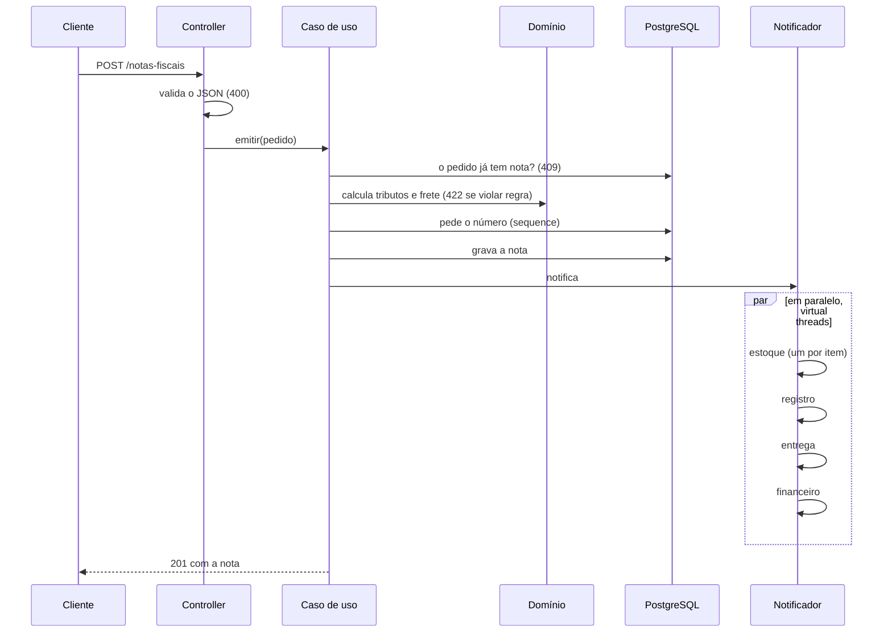
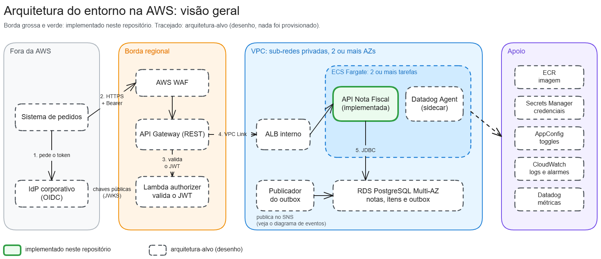

# Nota Fiscal API

API que **recebe um pedido, calcula tributos e frete, gera a nota fiscal e notifica os sistemas de estoque, registro, entrega e financeiro.**

Solução do desafio técnico de Engenharia de Software Sênior (Kotlin). O código legado não foi compartilhado, então a API foi construída do zero. Cada sintoma relatado no legado virou um requisito que o design evita e um teste de regressão que o prova (veja [Problema, solução e prova](#problema-solução-e-prova)).

## Sumário

- [Stack](#stack)
- [Como rodar](#como-rodar)
- [Contrato da API](#contrato-da-api)
- [Regras de negócio](#regras-de-negócio)
- [Problema, solução e prova](#problema-solução-e-prova)
- [Arquitetura](#arquitetura)
- [Observabilidade](#observabilidade)
- [Qualidade e CI](#qualidade-e-ci)
- [Configuração](#configuração)
- [Documentação adicional](#documentação-adicional)
- [Como usei IA neste projeto](#como-usei-ia-neste-projeto)
- [Limitações conhecidas e o que ficou de fora](#limitações-conhecidas-e-o-que-ficou-de-fora)

## Stack

| Área | Tecnologia |
|---|---|
| Linguagem | Kotlin 2.3, Java 21 |
| Framework | Spring Boot 4.1 (Spring MVC), virtual threads habilitadas |
| Persistência | PostgreSQL 18, `JdbcClient` (SQL explícito), Flyway |
| Observabilidade | Actuator, Micrometer (Prometheus), logs estruturados ECS |
| Testes | JUnit 5, AssertJ, Testcontainers (PostgreSQL), MockMvc |
| Qualidade | JaCoCo (cobertura mínima de 90% de linhas), ktlint |
| Build | Maven com Maven Wrapper |
| Contêiner | Docker (Dockerfile em duas etapas, usuário não-root) e Docker Compose |
| CI | GitHub Actions |

## Como rodar

Há dois caminhos. O primeiro precisa só do Docker.

### Opção 1: tudo com um comando (Docker)

Pré-requisito: **Docker**. Não é preciso ter JDK nem Maven instalados.

```bash
docker compose up --build
```

Isso constrói a imagem da aplicação (build em duas etapas, com o jar rodando como usuário não-root), sobe o PostgreSQL, espera o banco ficar saudável e só então inicia a API em `http://localhost:8080`. Na primeira vez o build baixa as dependências e leva alguns minutos; as seguintes usam cache. Use `-d` para rodar em segundo plano e `docker compose down` para parar (acrescente `-v` para apagar também o banco).

### Opção 2: desenvolvimento (aplicação pelo Maven)

Pré-requisitos: **JDK 21** e **Docker** (para o PostgreSQL e para os testes de integração, que usam Testcontainers). O Maven não precisa estar instalado: o projeto traz o Maven Wrapper.

Suba só o banco e rode a aplicação pelo Maven:

```bash
docker compose up -d postgres

# Linux/macOS
./mvnw spring-boot:run

# Windows (PowerShell)
.\mvnw.cmd spring-boot:run
```

Banco `notafiscal`, usuário e senha `notafiscal`, porta `5432`; os valores podem ser trocados por variáveis de ambiente (veja [Configuração](#configuração)). As migrações do Flyway rodam automaticamente na inicialização.

### Conferir que está de pé

```bash
curl http://localhost:8080/actuator/health
```

### Emitir uma nota

Salve o JSON do [exemplo de entrada](#entrada) em `pedido.json` e envie:

```bash
curl -i -X POST http://localhost:8080/notas-fiscais \
  -H "Content-Type: application/json; charset=utf-8" \
  --data-binary @pedido.json
```

> No Windows, prefira enviar o corpo por arquivo (`--data-binary @pedido.json`) em UTF-8. Passar JSON com acentos direto na linha de comando pode mandar os bytes na codificação do console e a API responde 400 "não é um JSON válido".

O `id_pedido` é idempotente: reenviar o mesmo pedido devolve **409** com o número da nota já emitida. Para repetir o exemplo, troque o `id_pedido` ou recrie o banco (`docker compose down -v`).

### Testes

```bash
./mvnw test      # testes
./mvnw verify    # tudo que o CI faz: ktlint, testes, relatório e portão de cobertura
```

Os testes que sobem o contexto Spring precisam do Docker ligado. O relatório de cobertura fica em `target/site/jacoco/index.html`.

Para corrigir o estilo automaticamente: `./mvnw ktlint:format`.

## Contrato da API

`POST /notas-fiscais` responde **201 Created** com a nota no corpo. O JSON usa `snake_case`. Valores monetários são lidos direto como `BigDecimal`, nunca por `Double`.

### Entrada

```json
{
  "id_pedido": "PED-1001",
  "data": "2026-11-18",
  "cliente": {
    "tipo_pessoa": "JURIDICA",
    "documento": "12345678000199",
    "nome": "Empresa Exemplo Ltda",
    "regime_tributacao": "LUCRO_PRESUMIDO",
    "enderecos": [
      {
        "finalidade": "COBRANCA_ENTREGA",
        "regiao": "SUDESTE",
        "logradouro": "Av. Paulista",
        "numero": "1000",
        "cidade": "São Paulo",
        "estado": "SP",
        "cep": "01310100"
      }
    ]
  },
  "itens": [
    { "id_item": "SKU-1", "descricao": "Notebook", "quantidade": 2, "valor_unitario": 1500.00 }
  ],
  "valor_frete": 50.00
}
```

| Campo | Valores / regra | Se violar |
|---|---|---|
| `id_pedido`, `data`, `cliente`, `itens`, `valor_frete` | obrigatórios | 400 |
| `tipo_pessoa` | `FISICA` ou `JURIDICA` | 400 |
| `documento` | só dígitos: 11 (CPF) para pessoa física, 14 (CNPJ) para jurídica | 400 |
| `regime_tributacao` (PJ) | `SIMPLES_NACIONAL`, `LUCRO_REAL`, `LUCRO_PRESUMIDO` ou `OUTROS` | 400 se o valor não existe |
| `finalidade` | `ENTREGA`, `COBRANCA_ENTREGA` ou `COBRANCA` | 400 |
| `regiao` | `NORTE`, `NORDESTE`, `CENTRO_OESTE`, `SUDESTE` ou `SUL` | 400 |
| `itens` | ao menos 1 | 400 |
| `quantidade` | inteiro maior que 0 | 400 |
| `valor_unitario` | maior que 0, no máximo 2 casas (rejeita, não arredonda) | 400 |
| `valor_frete` | maior ou igual a 0 (zero = frete grátis), no máximo 2 casas | 400 |
| PJ sem `regime_tributacao` ou com `OUTROS` | regra de negócio | 422 |
| nenhum endereço de entrega, ou mais de um | regra de negócio | 422 |
| `id_pedido` que já tem nota emitida | conflito | 409 |
| PF enviando `regime_tributacao` | ignorado | n/a |

Um endereço de entrega é um endereço com finalidade `ENTREGA` ou `COBRANCA_ENTREGA`. O pedido precisa ter **exatamente um** (a região dele define o frete). `COBRANCA` não conta.

### Resposta (201)

```json
{
  "numero_nota": 8,
  "id_pedido": "PED-1001",
  "data_emissao": "2026-11-20T17:46:38-03:00",
  "cliente": {
    "tipo_pessoa": "JURIDICA",
    "documento": "12345678000199",
    "nome": "Empresa Exemplo Ltda",
    "regime_tributacao": "LUCRO_PRESUMIDO"
  },
  "aliquota_percentual": 16.00,
  "itens": [
    {
      "id_item": "SKU-1",
      "descricao": "Notebook",
      "quantidade": 2,
      "valor_unitario": 1500.00,
      "valor_total": 3000.00,
      "valor_tributo": 480.00
    }
  ],
  "frete": { "regiao": "SUDESTE", "valor_base": 50.00, "percentual": 4.80, "valor": 52.40 },
  "total_itens": 3000.00,
  "total_tributos": 480.00,
  "total_nota": 3532.40
}
```

Conferência: 2 × 1.500,00 = 3.000,00 (faixa de 16% do Lucro Presumido, acima de 2.000,00 e até 5.000,00), tributo de 480,00, frete de 50,00 com acréscimo de 4,8% da região Sudeste = 52,40, total de 3.000,00 + 480,00 + 52,40 = **3.532,40**.

O `numero_nota` e a `data_emissao` mudam a cada emissão.

### Erros

Os erros seguem o **RFC 9457** (`application/problem+json`), com o campo extra `codigo` e o `correlation_id` da requisição.

| Status | Quando | `codigo` |
|---|---|---|
| 400 | Entrada inválida (estrutura, tipo, enum ou valor) | `REQUISICAO_INVALIDA`, com a lista `campos` |
| 409 | Pedido já emitido | `PEDIDO_JA_EMITIDO`, com `numero_nota` |
| 422 | Regra de negócio violada | `REGIME_TRIBUTARIO_INVALIDO`, `ENDERECO_ENTREGA_AUSENTE`, `ENDERECO_ENTREGA_AMBIGUO` |
| 500 | Erro inesperado (mensagem genérica, detalhes só no log) | `ERRO_INTERNO` |

400, com todos os campos inválidos listados juntos:

```json
{
  "detail": "Um ou mais campos são inválidos.",
  "instance": "/notas-fiscais",
  "status": 400,
  "title": "Requisição inválida",
  "codigo": "REQUISICAO_INVALIDA",
  "correlation_id": "17a384a5-bc71-48ef-9cef-cffba69eb43b",
  "campos": [{ "campo": "id_pedido", "mensagem": "é obrigatório" }]
}
```

409, ao reenviar o mesmo pedido:

```json
{
  "detail": "Pedido PED-1001 já teve a nota fiscal 8 emitida; nenhuma nota nova foi gerada.",
  "instance": "/notas-fiscais",
  "status": 409,
  "title": "Pedido já emitido",
  "codigo": "PEDIDO_JA_EMITIDO",
  "correlation_id": "c36ff2ea-af85-4c34-8224-2483a67b8b86",
  "numero_nota": 8
}
```

422, PJ com regime `OUTROS`:

```json
{
  "detail": "Pessoa jurídica com regime de tributação OUTROS não pode ter nota gerada.",
  "instance": "/notas-fiscais",
  "status": 422,
  "title": "Regra de negócio violada",
  "codigo": "REGIME_TRIBUTARIO_INVALIDO",
  "correlation_id": "5a1e86a4-e1c2-4876-859e-1e0dc8e841ad"
}
```

### Correlation id

A API aceita o cabeçalho `X-Correlation-Id` (letras, números e hífen, até 64 caracteres). Se ele não vier, ou vier num formato inválido, é gerado um UUID. O valor volta no cabeçalho da resposta, no `correlation_id` dos erros e em todos os logs da requisição, inclusive os das integrações.

## Regras de negócio

- **Total dos itens** = soma de `valor_unitario × quantidade` de cada item.
- **Faixa de alíquota** definida pelo **total dos itens do pedido** (não pelo item).
- **Tributo de cada item** calculado sobre o total do item e arredondado por item; o tributo da nota é a soma dos tributos já arredondados.
- **Total da nota** = total dos itens + total dos tributos + frete.
- Todo valor monetário usa `BigDecimal`, **2 casas decimais e `RoundingMode.HALF_EVEN`**.

### Alíquota, pessoa física

| Total dos itens | Alíquota |
|---|---|
| até 499,99 | 0% |
| 500,00 a 2.000,00 | 12% |
| 2.000,01 a 3.500,00 | 15% |
| acima de 3.500,00 | 17% |

### Alíquota, pessoa jurídica

| Total dos itens | Simples Nacional | Lucro Real | Lucro Presumido |
|---|---|---|---|
| até 999,99 | 3% | 3% | 3% |
| 1.000,00 a 2.000,00 | 7% | 9% | 9% |
| 2.000,01 a 5.000,00 | 13% | 15% | 16% |
| acima de 5.000,00 | 19% | 20% | 20% |

PJ sem regime informado, ou com regime `OUTROS`, não pode ter a nota gerada (422).

### Frete

O percentual da região do endereço de entrega é aplicado sobre `valor_frete`:

| Região | Acréscimo |
|---|---|
| NORTE | 8% |
| NORDESTE | 8,5% |
| CENTRO_OESTE | 7% |
| SUDESTE | 4,8% |
| SUL | 6% |

**Interpretação adotada:** o percentual da região é um **acréscimo** sobre o frete informado: `frete = valor_frete × (1 + percentual)`, arredondado uma única vez no fim (2 casas, `HALF_EVEN`). O frete não entra na base do tributo; entra somando no total da nota. Exemplo com `valor_frete = 50,00`:

| Região | Percentual | Frete da nota |
|---|---|---|
| NORTE | 8% | 54,00 |
| NORDESTE | 8,5% | 54,25 |
| CENTRO_OESTE | 7% | 53,50 |
| SUDESTE | 4,8% | 52,40 |
| SUL | 6% | 53,00 |

Meio centavo vai para o par mais próximo: `valor_frete = 1,00` no Nordeste dá 1,085, que vira **1,08**.

O enunciado permite outra leitura: o frete ser só o percentual do valor informado (50,00 × 4,8% = 2,40 no Sudeste). A leitura adotada foi o acréscimo porque a coluna da tabela se chama "Acréscimo" e a outra daria um frete muito menor que o informado. É uma **decisão assumida, não confirmada com o time**. A regra está isolada na classe `CalculadoraFrete`; se o time indicar a outra leitura, a mudança fica concentrada na fórmula e nos testes dessa classe.

### Numeração

Cada nota tem um número **sequencial e único**, gerado por uma sequence do PostgreSQL (`nota_fiscal_numero_seq`) e usado como chave primária. Sequences podem deixar lacunas se uma transação for revertida; a unicidade é garantida, a ausência de lacunas não.

## Problema, solução e prova

Os sintomas do legado e como o design os evita. Cada um tem um grupo de testes com o nome do sintoma, em `SintomasDoLegadoTest`, que roda contra a aplicação inteira: Tomcat com virtual threads, requisições HTTP reais, PostgreSQL 18 no Testcontainers e as latências reais das integrações.

| Sintoma | Como o design evita | Teste que comprova |
|---|---|---|
| A 1ª execução funciona e, nas seguintes, os itens de execuções anteriores se acumulam | Domínio imutável (`data class`, `val`, `List` somente leitura); estado da emissão só em variáveis locais; nenhum bean com estado mutável | `cada emissão devolve só os próprios itens` (3 emissões seguidas); `BeansSemEstadoMutavelTest` |
| Pedidos com mais de 6 itens demoram muito | Notificações em paralelo com virtual threads (uma baixa de estoque por item, mais registro, entrega e financeiro, todos juntos); a latência simulada é mantida | `pedido com 10 itens demora o mesmo que pedido com 1 item` |
| Após algumas execuções o retorno fica lento | Nada cresce em memória entre requisições; o estado durável fica só no PostgreSQL | `latência continua estável ao longo de várias execuções` (30 emissões) |
| Requisições simultâneas processadas uma por vez | Tomcat com virtual threads; nenhum `synchronized` nem lock global | `20 requisições simultâneas terminam em paralelo` |
| Centavos "sumindo" ou "sobrando" | `BigDecimal`, escala 2, `HALF_EVEN`, arredondamento por item, total igual à soma das partes já arredondadas; nunca `Double` | `nota do contrato fecha em 3532,40`; `totais fecham com a soma das partes arredondadas`; todos os limites de faixa nos testes das calculadoras |
| Notas com numeração duplicada | Sequence do PostgreSQL com `numero` como chave primária; `id_pedido` único com `on conflict do nothing` | `30 emissões simultâneas recebem números distintos`; `mesmo pedido enviado 10 vezes ao mesmo tempo gera uma única nota` |
| Dados incompletos geram 500 sem explicação, ou notas sem itens ou sem frete | Validação de entrada (400 com o campo) e regras de negócio no domínio (422), com `ProblemDetail` | `pedido sem itens é recusado com 400 explicando o campo`; `pedido sem frete é recusado com 400 explicando o campo`; `corpo vazio é recusado com 400, nunca 500`; `pedido recusado por regra de negócio não grava nota`; um teste por regra em `NotaFiscalErrosTest` |

Os limites de faixa (499,99 / 500,00 / 2.000,00 / 2.000,01 / 3.500,00 / 3.500,01 e os equivalentes de pessoa jurídica) são testados um a um em `CalculadoraTributoTest`.

**Os testes foram validados com sabotagem controlada**, para provar que não passam sem estar certos: com as notificações em sequência falhou o teste dos 10 itens; com `@Synchronized` no caso de uso falhou o teste das requisições simultâneas (o grupo foi de cerca de 2 s para 28 s); com `var` e `mutableListOf` num bean falhou o `BeansSemEstadoMutavelTest`. Tudo revertido depois.

Os demais problemas relatados (código difícil de manter, regras e fluxo complexos, classe principal instável, baixa cobertura) são tratados pela arquitetura hexagonal, por regras isoladas em classes pequenas e testáveis, e pelo portão de cobertura no CI.

## Arquitetura

Arquitetura hexagonal. O **domínio é Kotlin puro, sem Spring**, e o framework só aparece nos adapters e na configuração.

```
src/main/kotlin/br/com/itau/notafiscal/
  domain/
    model/        Pedido, Item, Cliente (PF/PJ), Endereco, NotaFiscal, Dinheiro, Tributacao, Frete
    service/      CalculadoraTributo, CalculadoraFrete (regras puras)
    exception/    erros de regra de negócio
  application/
    port/in/      EmitirNotaFiscalUseCase
    port/out/     NotaFiscalRepository, GeradorNumeroNota, MetricasNotaFiscal, sistemas notificados
    service/      NotificadorSistemas (integrações em paralelo)
    usecase/      EmitirNotaFiscalService (orquestra a emissão)
  adapter/
    in/web/       controller, DTOs, mapeamento, filtro de correlation id, tratador de erros
    out/persistence/  repositório JDBC, gerador de número (sequence)
    out/integracao/   estoque, registro, entrega e financeiro simulados (latência configurável)
    out/metricas/     adapter Micrometer
  config/         beans e propriedades (latências das integrações)
```

### Fluxo de uma emissão



### Decisões principais

| Decisão | Por quê |
|---|---|
| Domínio imutável e sem Spring | Elimina o acúmulo de itens entre execuções e deixa as regras testáveis sem framework |
| Número pedido só depois dos cálculos | Uma recusa 422 não consome número da sequence |
| Idempotência por `id_pedido` em duas camadas | Consulta prévia no caso de uso (409 sem gastar número) mais `on conflict do nothing` para a corrida entre requisições simultâneas |
| `JdbcClient` em vez de JPA | SQL explícito, domínio imutável sem entidades mutáveis, gravação única por emissão |
| Virtual threads nas integrações | Paralelismo sem trocar o modelo de programação; a latência simulada é mantida (`Thread.sleep`) |
| Notificação após gravar; falha de um sistema não afeta os outros | A nota já está persistida; a falha vai para o log e para a métrica `notafiscal.notificacoes.falhas` |
| Maven em vez de Gradle | Mais familiaridade da equipe; o desafio não exige ferramenta de build |

### Integrações simuladas

Estoque (uma baixa por item), registro, entrega e financeiro são simuladas com `Thread.sleep` configurável (padrão 300, 200, 400 e 250 ms). O tempo **não foi removido**, como pede o desafio: o ganho vem de executá-las em paralelo, então o tempo de um pedido fica próximo ao da integração mais lenta, e não à soma delas.

## Observabilidade

O Actuator está na mesma porta da API (8080).

| Endpoint | O que mostra |
|---|---|
| `/actuator/health` | Saúde geral, incluindo o PostgreSQL |
| `/actuator/health/liveness` | O processo está vivo (se falhar, o orquestrador reinicia) |
| `/actuator/health/readiness` | Pode receber tráfego (se falhar, o load balancer tira da rota) |
| `/actuator/info` | Nome e versão do build |
| `/actuator/metrics` | Lista das métricas (e `/actuator/metrics/<nome>` para uma delas, em JSON) |
| `/actuator/prometheus` | Todas as métricas em formato Prometheus |

### Métricas de negócio

| Métrica | Tags | O que conta |
|---|---|---|
| `notafiscal.emitidas` | `tipo_pessoa`, `regiao_entrega` | Notas emitidas |
| `notafiscal.recusadas` | `codigo` | Respostas de erro (400, 409, 422 e 500) por código |
| `notafiscal.notificacoes.falhas` | `sistema` | Falhas de integração por sistema |

No formato Prometheus os nomes ficam `notafiscal_emitidas_total` e assim por diante. Um contador que nunca foi incrementado não aparece. A latência por endpoint vem pronta do Spring (`http_server_requests_seconds`), junto com as métricas de JVM, do pool de conexões (HikariCP) e do Tomcat. As tags têm poucos valores possíveis de propósito: nada de `id_pedido` ou número da nota como tag, para não multiplicar séries.

As métricas ficam em memória e zeram quando a aplicação reinicia. A coleta é por **pull**: uma ferramenta externa (Datadog Agent, Prometheus) lê `/actuator/prometheus` periodicamente. Não há Prometheus, Grafana ou Datadog neste repositório.

### Logs

Localmente o log é texto, com o correlation id entre colchetes. Em container, defina `LOGGING_STRUCTURED_FORMAT_CONSOLE=ecs` para JSON no formato ECS, com o correlation id em cada linha.

## Qualidade e CI

- **Testes:** 146, entre unidade (domínio, caso de uso), web (MockMvc), persistência (PostgreSQL real no Testcontainers) e a suíte de sintomas do legado.
- **Cobertura:** JaCoCo, com o build **reprovando abaixo de 90% de linhas**. Na última medição: 97,4% de linhas e 84,7% de ramos.
- **Lint:** ktlint, executado no `verify` e no CI. O `.editorconfig` desliga duas regras de forma deliberada: o nome de pacote (o pacote `in` de `adapter.in` e `port.in` exige crases em Kotlin) e o nome de classe nos testes (nomes aninhados em português).
- **CI:** GitHub Actions (`.github/workflows/ci.yml`), em todo push e pull request na `master`: ktlint, `mvnw verify` (testes com Testcontainers, relatório e portão de cobertura) e publicação dos relatórios como artefato, mesmo quando o build falha.

## Configuração

Por variável de ambiente ou `application.properties`. Nenhum segredo fica no repositório.

| Variável / propriedade | Padrão | Para quê |
|---|---|---|
| `POSTGRES_HOST` | `localhost` | Host do banco |
| `POSTGRES_PORT` | `5432` | Porta do banco |
| `POSTGRES_DB` | `notafiscal` | Nome do banco |
| `POSTGRES_USER` | `notafiscal` | Usuário do banco |
| `POSTGRES_PASSWORD` | `notafiscal` | Senha do banco (valor de desenvolvimento; em produção viria de um gerenciador de segredos) |
| `APP_PORT` | `8080` | Porta publicada da API no `docker compose` |
| `nota-fiscal.integracoes.latencia.estoque` / `.registro` / `.entrega` / `.financeiro` | `300ms` / `200ms` / `400ms` / `250ms` | Latência simulada de cada integração |
| `LOGGING_STRUCTURED_FORMAT_CONSOLE` | não definido | `ecs` liga o log em JSON |

## Documentação adicional

- [Arquitetura do entorno (AWS)](docs/arquitetura-aws.md): gateway, autenticação, rede, dados e eventos, observabilidade, e o que está implementado contra o que é arquitetura-alvo.



## Como usei IA neste projeto

Usei o Claude Code (Anthropic) como apoio ao desenvolvimento, em sessões de trabalho em passos pequenos.

### Para que usei

- Montar a estrutura inicial do projeto e o esqueleto da arquitetura hexagonal.
- Gerar casos de teste, principalmente os limites de faixa de alíquota e as combinações de erro.
- Escrever e revisar documentação: este README e o registro das decisões.
- Aprender Kotlin: venho de Java, e pedi que cada recurso novo (`data class`, `when` exaustivo, `takeIf`, escopos) fosse explicado e comparado com o equivalente em Java.
- Apontar lacunas em revisões, por exemplo a de que respostas 404, 405 e 415 não passam pelo tratador de erros da aplicação.

### Como verifiquei o que a IA produziu

- Os testes verificam comportamento, e não só executam linhas. Reintroduzi defeitos típicos do legado de propósito (notificações em sequência, `@Synchronized`, estado mutável num bean) para provar que a suíte falha quando deve.
- Rodei a aplicação de verdade e conferi respostas, métricas e logs. Os exemplos deste README são respostas reais capturadas da API.
- Testei o portão de cobertura no CI subindo o mínimo para 99% de propósito, e conferi nos logs do GitHub Actions.
- Revisei os resultados antes de seguir para cada etapa grande.

## Limitações conhecidas e o que ficou de fora

Registradas aqui com o motivo, para não parecerem esquecimento.

- **Notificação síncrona.** As integrações rodam em paralelo, mas dentro da requisição: a resposta só sai depois de todas. Se um sistema falhar, a falha é logada e contada, **sem nova tentativa**. A solução de produção seria o padrão **outbox** (a nota e o evento gravados na mesma transação, publicados em SNS e uma fila SQS por sistema, com DLQ). Não foi implementado; ficou como arquitetura-alvo.
- **Respostas padrão do Spring (404, 405 e 415).** Saem sem os campos `codigo` e `correlation_id` no corpo e não entram na métrica `notafiscal.recusadas`, porque não passam pelo tratador de erros da aplicação. O cabeçalho `X-Correlation-Id` continua presente. Verificado com um `GET` em `/notas-fiscais` (405). Não afeta o fluxo de emissão e ficou de fora por decisão de escopo.
- **Sem autenticação na própria API.** Autenticação e autorização ficam no gateway (desenho da arquitetura de entorno).
- **Actuator na mesma porta.** Em produção deve ficar numa porta de gestão separada, acessível só dentro da rede, nunca pelo gateway.
- **Percentil de latência (p99).** Não está disponível: o Spring publica por padrão só contagem, soma e máximo. Habilitar exige uma propriedade de histograma que não foi configurada.
- **Tracing distribuído.** Há correlation id próprio, e não OpenTelemetry. O tracing (W3C `traceparent`) é a evolução natural, mas exige coletor e dependências adicionais.
- **Lacunas na numeração.** A sequence do PostgreSQL pode pular números em caso de rollback.
- **CI sem build de imagem, deploy nem varredura de dependências.** O pipeline cobre lint, testes e cobertura.
