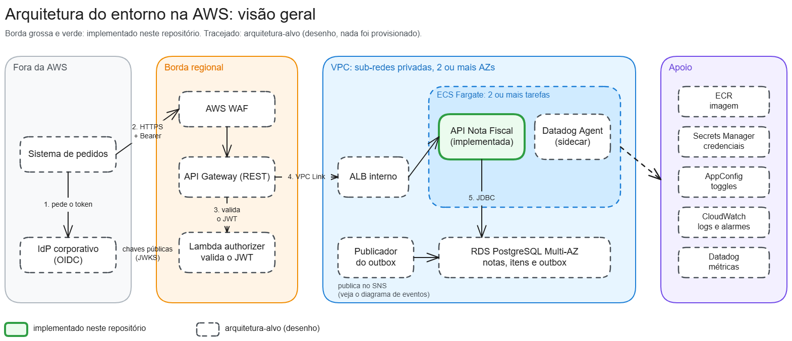
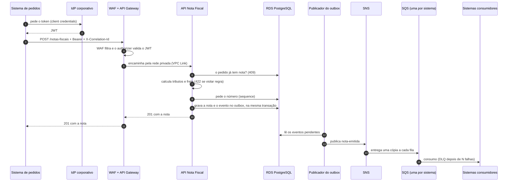
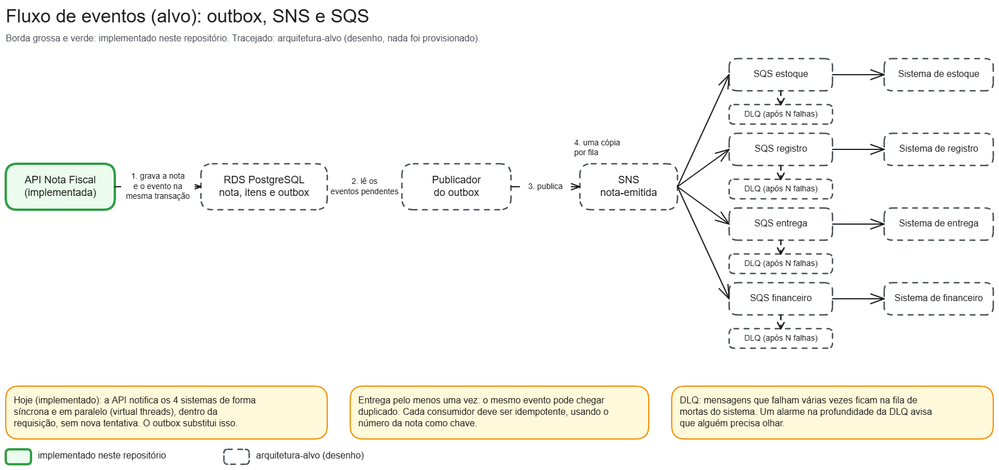

# Arquitetura do entorno (AWS)

Desenho do que existe ao redor da API Nota Fiscal em produção: gateway, autenticação, rede, dados, eventos e observabilidade.

> **Leia isto primeiro.** Este documento mistura o que **já existe neste repositório** com a **arquitetura-alvo**. Nos diagramas, a API aparece com borda grossa (implementada) e o resto com borda tracejada (alvo, só desenhado). A seção [Implementado e alvo](#implementado-e-alvo) lista cada ponto.

> **Diagramas editáveis.** As imagens foram exportadas do Excalidraw. Os arquivos-fonte estão em [`arquitetura-aws-entorno.excalidraw`](arquitetura-aws-entorno.excalidraw) (visão geral) e [`arquitetura-aws-eventos.excalidraw`](arquitetura-aws-eventos.excalidraw) (fluxo de eventos); abra em [excalidraw.com](https://excalidraw.com) (menu, *Open*) para editar. Os PNGs em `docs/img/` também reabrem no Excalidraw, porque levam a cena embutida.

## Sumário

- [Visão geral](#visão-geral)
- [Diagrama do entorno](#diagrama-do-entorno)
- [Fluxo de uma requisição](#fluxo-de-uma-requisição)
- [Componentes e por que cada um](#componentes-e-por-que-cada-um)
- [Autenticação e autorização](#autenticação-e-autorização)
- [Dados e eventos](#dados-e-eventos)
- [Segredos, configuração e feature toggles](#segredos-configuração-e-feature-toggles)
- [Observabilidade](#observabilidade)
- [Escala e resiliência](#escala-e-resiliência)
- [Implementado e alvo](#implementado-e-alvo)
- [Decisões e trade-offs](#decisões-e-trade-offs)
- [O que não foi verificado](#o-que-não-foi-verificado)
- [Fontes](#fontes)

## Visão geral

O sistema de pedidos chama a API por HTTPS com um token OAuth2 emitido pelo **IdP corporativo**. A requisição passa pelo **AWS WAF** e pelo **API Gateway**, que valida o token e encaminha pela rede privada para a **API**, rodando em **ECS Fargate**. A API grava a nota no **RDS PostgreSQL** e, **na mesma transação**, grava um evento numa tabela *outbox*. Um publicador lê o outbox e publica no **SNS**, que entrega uma cópia a **uma fila SQS por sistema** (estoque, registro, entrega, financeiro), cada uma com sua DLQ.

A API **não implementa autenticação**: ela só é alcançável pelo gateway, por rede privada (veja [Autenticação e autorização](#autenticação-e-autorização)).

## Diagrama do entorno

Os números 1 a 5 seguem a ordem da requisição: o pedido obtém o token (1), chama pelo WAF (2), o gateway valida o JWT (3), encaminha pelo VPC Link (4) e a API grava no banco (5). O fluxo de eventos tem diagrama próprio em [Dados e eventos](#dados-e-eventos).

## Fluxo de uma requisição

Fluxo-alvo, com o outbox. Hoje, no código, as notificações são **síncronas e em paralelo** dentro da requisição (veja [Implementado e alvo](#implementado-e-alvo)).

## Componentes e por que cada um

| Componente | Papel | Por quê |
|---|---|---|
| **AWS WAF** | Filtra tráfego malicioso (regras gerenciadas, limite de taxa por origem) antes da API | Protege a borda; associa-se direto à API REST do API Gateway |
| **API Gateway (REST)** | Entrada única: valida o token, aplica limite de requisições (usage plan) e encaminha | Centraliza autenticação, throttling e a política de borda, sem código na API |
| **Lambda authorizer** | Valida o JWT do IdP corporativo (assinatura, emissor, público, validade, escopo) | A API REST não tem autorizador JWT nativo; o resultado fica em cache para não validar a cada chamada |
| **VPC Link + ALB interno** | Liga o gateway à API por rede privada | A API nunca fica exposta à internet; o ALB faz o health check |
| **ECS Fargate** | Roda a imagem do `Dockerfile`, 2 ou mais tarefas em 2 ou mais AZs | Sem servidores nem cluster para operar; escala por CPU ou por requisições |
| **RDS PostgreSQL Multi-AZ** | Guarda notas, itens e outbox; a sequence gera a numeração | O mesmo PostgreSQL do desenvolvimento; failover automático; backup e restauração por ponto no tempo |
| **Publicador do outbox** | Lê os eventos gravados na transação e publica no SNS | Garante que nota e evento nasçam juntos, sem perder evento se a publicação falhar |
| **SNS + uma SQS por sistema (com DLQ)** | Distribui `nota-emitida` e isola cada consumidor | Um sistema lento ou fora do ar não atrasa os outros; a DLQ guarda o que falhou |
| **ECR** | Guarda a imagem | Origem da imagem que o ECS executa |
| **Secrets Manager** | Guarda as credenciais do banco | Nenhum segredo no repositório nem na imagem |
| **AppConfig** | Feature toggles com liberação gradual | Ligar e desligar comportamento sem novo deploy |
| **Datadog Agent (sidecar) e CloudWatch** | Métricas, logs e alarmes | Datadog é o alvo do case; CloudWatch cobre o básico da plataforma |

## Autenticação e autorização

**Fluxo.** O sistema de pedidos obtém um token no IdP corporativo (fluxo *client credentials*, comunicação entre sistemas) e o envia em `Authorization: Bearer`. O gateway valida o token antes de a requisição chegar à API. Um escopo como `notas:emitir` define quem pode chamar o endpoint.

**A API não implementa autenticação.** Essa é uma escolha de arquitetura, e ela só é segura se a API for **inalcançável por fora do gateway**:

- as tarefas ECS ficam em sub-redes **privadas**, sem IP público;
- o security group da API aceita tráfego **só do ALB interno**, e o ALB só do VPC Link;
- o banco aceita conexões **só da API** (e do publicador do outbox);
- o Actuator fica numa porta de gestão separada, aberta só ao Datadog Agent e aos health checks, **nunca** pelo gateway.

**Defesa em profundidade (evolução).** Para não depender só da rede, a API poderia **revalidar o JWT** como *resource server* (Spring Security), conferindo emissor, público e escopo. Custa pouco código, mas é uma segunda camada que **não está implementada**: hoje o repositório confia que o tráfego só chega pelo gateway.

**Autorização por dado.** O escopo diz *quem pode emitir*, mas não limita *o que cada cliente pode emitir*. Se houvesse mais de um sistema de pedidos com visões separadas, seria preciso uma regra dentro da API. O case não pede isso.

## Dados e eventos

- **Numeração e idempotência** vivem no banco (sequence e `id_pedido` único), e por isso funcionam com **várias instâncias** da API ao mesmo tempo.
- **Outbox.** A nota e o evento são gravados na **mesma transação**: ou os dois existem, ou nenhum. O publicador lê o que ainda não foi publicado e marca como publicado depois. Isso troca a notificação síncrona de hoje (sem nova tentativa se um sistema falhar) por **entrega pelo menos uma vez**.
- **Pelo menos uma vez** significa que um evento pode chegar duplicado. Cada consumidor deve ser **idempotente**, usando o número da nota como chave de deduplicação.
- **DLQ.** Mensagens que falham várias vezes vão para a fila de mensagens mortas de cada sistema. Um alarme na profundidade da DLQ avisa que alguém precisa olhar.
- **Ordem.** O fluxo não exige ordem entre notas, então filas padrão (não FIFO) bastam.
- **Backup.** RDS com backup automático e restauração por ponto no tempo; Multi-AZ para failover.

## Segredos, configuração e feature toggles

- **Segredos:** `POSTGRES_PASSWORD` e as demais credenciais vêm do **Secrets Manager**, injetadas como variáveis de ambiente na tarefa ECS. Nada vai para a imagem nem para o repositório. As variáveis que a aplicação já lê estão no README.
- **Configuração:** as demais variáveis (latência das integrações simuladas, formato de log) entram pela definição da tarefa.
- **Feature toggles:** o **AppConfig** serviria para ligar comportamento novo de forma gradual. Hoje a aplicação **não tem nenhum toggle** (o do frete foi removido), então o AppConfig aparece como capacidade futura, não como dependência.
- **Imagem:** a mesma imagem sobe em todos os ambientes; só a configuração muda.

## Observabilidade

- **Métricas.** A API expõe `/actuator/prometheus` (já implementado). O **Datadog Agent**, como sidecar, lê esse endpoint pela integração OpenMetrics. Nenhuma chave do Datadog fica na aplicação.
- **Logs.** Com `LOGGING_STRUCTURED_FORMAT_CONSOLE=ecs` a API escreve JSON no console; o ECS envia ao CloudWatch Logs e de lá ao Datadog. Cada linha leva o **correlation id**.
- **Correlation id.** O gateway pode injetar o `X-Correlation-Id` (por exemplo, a partir do id da requisição dele) quando o cliente não mandar. A API já o aceita, devolve nos cabeçalhos e nos erros e o propaga às threads das integrações.
- **Porta de gestão.** O Actuator deve usar uma porta separada (`management.server.port`), liberada só ao agente e aos health checks. Hoje ele roda na mesma porta da API.
- **Health checks.** O ALB usa `/actuator/health/readiness` para decidir se a tarefa recebe tráfego; o ECS usa `/liveness` para reiniciar uma tarefa travada.
- **Alarmes sugeridos:** erros 5xx e `ERRO_INTERNO`, falhas de notificação por sistema, profundidade das DLQs, tempo médio e máximo do `POST /notas-fiscais`, conexões pendentes no pool do banco e CPU do serviço.
- **Tracing.** Fica como evolução (OpenTelemetry com `traceparent`). Hoje o correlation id próprio resolve a investigação dentro desta API.

## Escala e resiliência

- **Sem estado em memória.** A API não guarda estado entre requisições (era o sintoma do legado), então escala horizontalmente: basta acrescentar tarefas. O autoscaling do ECS reage a CPU ou ao número de requisições por tarefa.
- **Virtual threads** absorvem muitas requisições simultâneas sem um pool de threads enorme.
- **Multi-AZ** em tudo que é stateful (RDS) e pelo menos 2 tarefas em AZs diferentes.
- **Limite de requisições** no gateway (usage plan) e no WAF (regra por origem) protege a API de picos e abuso.
- **Deploys** sem indisponibilidade (blue/green ou canário) e o critério de rollback ficam no plano de deploy e rollback (item 18), um documento à parte.
- **Banco.** O pool de conexões da API, multiplicado pelo número de tarefas, precisa caber no limite de conexões do RDS. Se o número de tarefas crescer muito, entra um proxy de conexões (RDS Proxy).

## Implementado e alvo

| Ponto | Estado | Observação |
|---|---|---|
| API em Kotlin (hexagonal, virtual threads) | **Implementado** | |
| PostgreSQL com sequence e `id_pedido` único | **Implementado** | Localmente em container; em produção seria o RDS |
| Imagem Docker e `docker compose` | **Implementado** | Dockerfile em duas etapas, usuário não-root |
| Actuator, métricas Prometheus, correlation id, logs ECS | **Implementado** | Porta de gestão ainda não separada |
| CI no GitHub Actions (lint, testes, cobertura) | **Implementado** | Sem build nem publicação da imagem |
| Notificação em paralelo (virtual threads) | **Implementado** | **Síncrona** dentro da requisição, sem nova tentativa |
| Outbox, SNS, SQS e DLQ | **Alvo** | Substitui a notificação síncrona; não implementado |
| WAF, API Gateway e Lambda authorizer | **Alvo** | A API não valida token |
| ECS Fargate, ALB, VPC Link, RDS Multi-AZ | **Alvo** | Só desenhado |
| Secrets Manager, AppConfig | **Alvo** | Nenhum toggle existe hoje |
| Datadog Agent, alarmes, tracing | **Alvo** | A API só expõe o endpoint de métricas |

## Decisões e trade-offs

| Decisão | Escolha | Alternativa | Por quê |
|---|---|---|---|
| Orquestração | **ECS Fargate** | EKS | Uma única API; sem cluster para operar. EKS passa a valer se o time já usa Kubernetes, e a imagem é a mesma |
| Identidade | **IdP corporativo (OIDC)** | Cognito | O banco já tem identidade corporativa; Cognito só para um sistema novo, sem IdP |
| Tipo de API no gateway | **REST** | HTTP API | O WAF só se associa direto à REST. A HTTP API é mais barata e tem JWT nativo, mas exigiria CloudFront ou ALB na frente para ter WAF |
| Integração gateway e API | **VPC Link V2 direto ao ALB** | NLB no meio | Há suporte recente a ALB na REST; guias antigos mandam usar NLB |
| Notificação | **Outbox, SNS e SQS** | Síncrona (hoje) | Entrega garantida e isolamento entre sistemas; custa uma tabela, um publicador e consumidores idempotentes |
| Métricas | **Agent lê o endpoint (pull)** | Push com biblioteca do Datadog | Formato aberto (Prometheus), sem chave na aplicação |
| Banco | **RDS PostgreSQL Multi-AZ** | Aurora | O mesmo PostgreSQL do desenvolvimento; Aurora vale se a escala exigir |
| Autenticação na API | **Só no gateway** | Revalidar o JWT na API | Menos código; exige rede privada. A revalidação é a evolução natural |

## O que não foi verificado

Este é um **desenho**: nada aqui foi provisionado nem testado na AWS. Os pontos abaixo dependem da conta e da versão dos serviços e devem ser confirmados antes de qualquer implantação:

- as **opções de autorizador** da API REST (a afirmação de que não há autorizador JWT nativo vem do meu conhecimento, não de uma consulta);
- **cotas e custos** (API Gateway, Lambda, NAT, Datadog, RDS Multi-AZ);
- o suporte a ALB por **VPC Link V2** na região escolhida;
- o dimensionamento (tarefas, CPU, memória, conexões do banco) sem teste de carga.

## Fontes

Conferidas em 20/11/2026:

- [Use AWS WAF to protect your REST APIs in API Gateway](https://docs.aws.amazon.com/apigateway/latest/developerguide/apigateway-control-access-aws-waf.html): o WAF se associa à API REST (a HTTP API não aparece como recurso suportado).
- [Private integrations for REST APIs in API Gateway](https://docs.aws.amazon.com/apigateway/latest/developerguide/private-integration.html): VPC Link V2 e integração com ALB.
- [Amazon API Gateway REST APIs now supports private integration with Application Load Balancer](https://aws.amazon.com/about-aws/whats-new/2025/11/api-gateway-rest-apis-integration-load-balancer): anúncio de novembro de 2025.

O plano de deploy e rollback (item 18) será um documento à parte.
